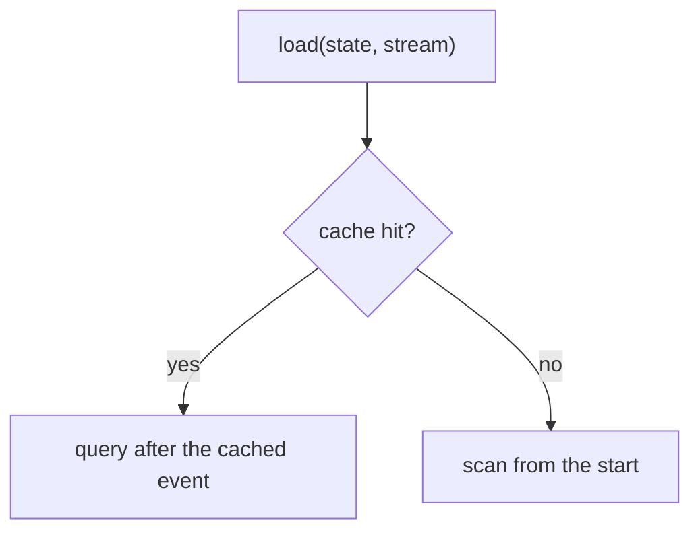

# Adding a diagram

The docs draw their diagrams from source in the repo, in one style, so a diagram gets reviewed in a PR like code and rebuilt with the site. There are two kinds. Pick by what the diagram shows.

| The diagram shows | Use | Examples |
|---|---|---|
| A flow, a decision tree, a state machine or a pipeline | a Mermaid block | `load()` in [cache and snapshots](../architecture/cache-and-snapshots.md), the [close phases](../architecture/close-cycle.md), the lease states in the [concurrency model](../architecture/concurrency-model.md) |
| Things happening at the same time, or a loop over time | an animated `<Scene>` | the commit race and the competing workers in the [concurrency model](../architecture/concurrency-model.md), the settle loop in [correlation and drain](../architecture/correlation-and-drain.md), SSE patches in [real-time](../concepts/real-time.md) |

Don't draw ASCII diagrams in code blocks. A directory tree is fine as a `text` block.

## Colors

Every diagram uses one color per concept, the same ones as the [flow animations](./flow-animations.md): actor, action, state, event, projection, reaction, external and store, plus `good` and `bad` for outcomes. The tokens are the `--dg-*` variables in `docs/src/css/custom.css`, with a light and a dark value each. Change a color there and every diagram follows.

Say action, reaction and projection, never command, policy or read model.

## A Mermaid diagram

Write a fenced `mermaid` block in the page. Tag a node with its concept using `:::concept`. Keep the text in decision diamonds to a few words, and put the detail on the edges or in the boxes.

````md

````

In a `stateDiagram-v2`, tag states with `class <state> <concept>` lines instead. GitHub renders Mermaid too, so the same block works in a README, just without the concept colors.

## An animated scene

A scene is an animated sequence diagram: participants across the top, and steps that draw themselves one at a time. All the messages in one step travel together. Write it as data in `docs/src/scenes/<name>.ts`:

```ts no-check
import type { SceneSpec } from "../components/Scene";

const scene: SceneSpec = {
  title: "Two workers drain one store",
  participants: [
    { id: "a", label: "worker A", kind: "reaction" },
    { id: "store", label: "store", kind: "store" },
    { id: "b", label: "worker B", kind: "reaction" },
  ],
  steps: [
    {
      say: "Two worker processes claim at the same moment.",
      messages: [
        { from: "a", to: "store", label: "claim(by: A)" },
        { from: "b", to: "store", label: "claim(by: B)" },
      ],
    },
    {
      say: "Each gets a lease on a different set of streams.",
      messages: [
        { from: "store", to: "a", label: "leases 1, 3, 5", tone: "good" },
        { from: "store", to: "b", label: "leases 2, 4", tone: "good" },
      ],
      notes: [{ at: "store", text: "B skips the rows A holds" }],
    },
  ],
};
export default scene;
```

Then put it on the page, with the imports right after the front matter:

```md
import Scene from "@site/src/components/Scene";
import competingWorkers from "@site/src/scenes/competing-workers";

<Scene scene={competingWorkers} />
```

- `say` is the caption for the step. Write one or two plain sentences, and wrap code in backticks.
- A message's `tone` (`good`, `bad`, `muted`) colors a verdict. Leave it off for ordinary calls.
- A note sits under one participant (`at: "store"`), or centered across two (`at: ["a", "b"]`). Notes in the same step share a row, and `\n` breaks a line.

The page renders the finished diagram on the server, so it reads without JavaScript. In the browser it plays once when scrolled into view, unless the reader prefers reduced motion. ‹ and › step through it.

## Keep it true

A diagram that shows how the code works has to match the code. When a PR changes the behavior a diagram draws, update the diagram in the same PR. Before redrawing one, read the code path it shows, not the old diagram.

Check every diagram in both themes (`pnpm -F docs start`, then toggle the theme). A broken Mermaid block shows an error in place of the diagram, and an unknown participant in a scene fails the build.
